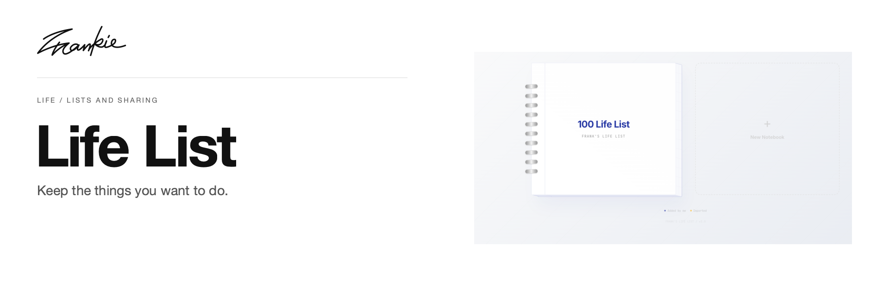

# Frank's Life List

[English](README.md) · [简体中文](README.zh-CN.md)

Keep the things you want to do, experience and finish in a list, with a lightweight way to compare it with someone else.

[Guide (中文)](docs/guide.md) · [Run locally](#run-locally)

## What it does

- Organize lists into groups and pages, tracking completion item by item.
- Share through a link or QR code and compare progress asynchronously.
- Continue your lists without registering an account.

## Run locally

```sh
npm ci
npm run dev
```

Open the URL printed by Vite. List features do not require an AI API key.

## Before you start

List state stays in this browser; different origins and devices do not automatically share it. Use the app’s links or QR codes to share and compare lists.

## For developers

```sh
npm run lint
npm run build
```

[Project guide (中文)](docs/guide.md) · [Artwork](docs/readme/README.md)

---

Made by [Songhai Fan](https://github.com/SonghaiFan) · A Frankie project
