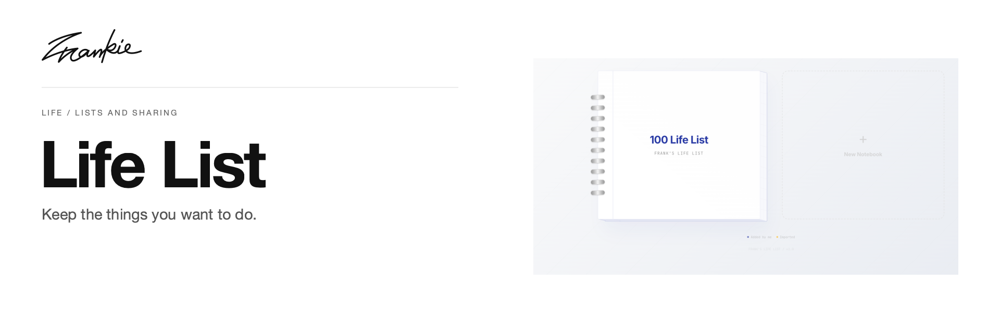

# Frank's Life List

[English](README.md) · [简体中文](README.zh-CN.md)

把想做、想经历、想完成的事情放进清单，也留一个轻量的方式与别人对齐。

[项目指南](docs/guide.md) · [本地运行](#本地运行)

## 可以做什么

- 用分组和分页整理清单，逐项记录完成状态。
- 通过链接或二维码分享，异步比较彼此的进度。
- 无需注册，打开后就能继续自己的列表。

## 本地运行

```sh
npm ci
npm run dev
```

打开 Vite 输出的地址。列表功能不需要 AI API key。

## 开始之前

列表状态保存在当前浏览器；不同地址和设备不会自动共享同一份状态。分享与对比通过应用提供的链接或二维码进行。

## 开发说明

```sh
npm run lint
npm run build
```

[项目指南](docs/guide.md) · [Banner 维护](docs/readme/README.md)

---

由 [Songhai Fan](https://github.com/SonghaiFan) 制作 · Frankie 系列项目
